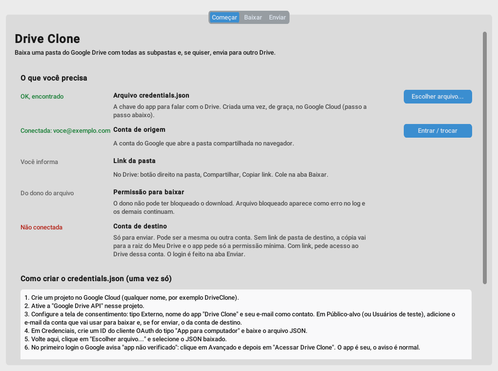
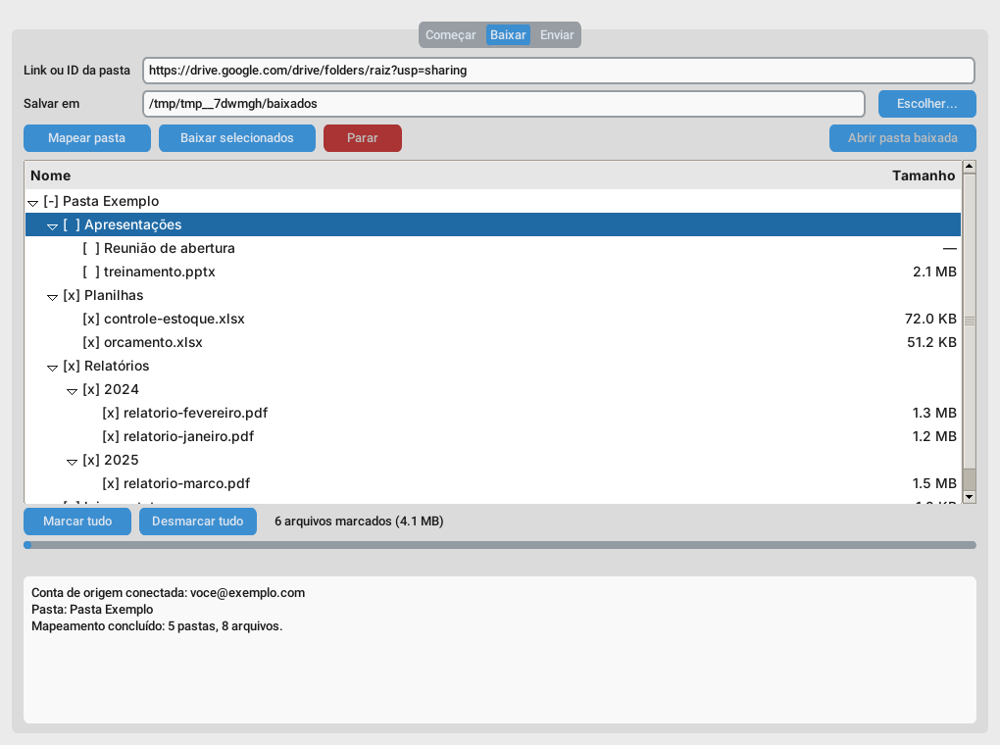
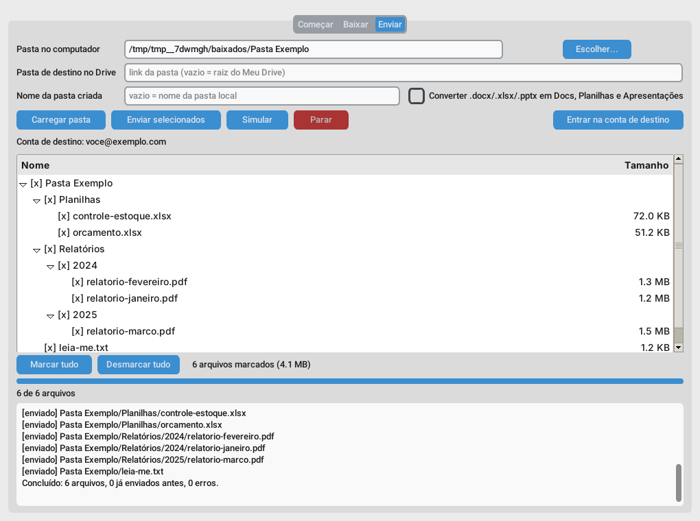

# Drive Clone

App de desktop para baixar uma pasta do Google Drive com todas as subpastas, mantendo a hierarquia, e enviar tudo (ou só o que você marcar) para outro Drive.



## Como usar

1. Abra o `DriveClone.exe` (ou `python run.py`).
2. Aba **Começar**: coloque o `credentials.json` (ou o `client_secret_...json` baixado do Google) na mesma pasta do programa, que ele importa sozinho, ou use **Escolher arquivo...**. O passo a passo para criar está na própria aba. Depois, entre na conta do Google.
3. Aba **Baixar**: cole o link da pasta, clique em **Mapear pasta**, marque o que quer e clique em **Baixar selecionados**.
4. Aba **Enviar**: carregue a pasta baixada, marque o que quer, entre na conta de destino e clique em **Enviar selecionados**. **Simular** mostra o que seria enviado sem enviar nada.





As capturas usam dados de exemplo.

## O que preciso do Drive

- Um `credentials.json` do tipo "App para computador" (Google Cloud, criado uma vez, de graça).
- A conta do Google que abre a pasta no navegador, adicionada como usuário de teste do app.
- O link da pasta de origem.
- Para enviar: a conta de destino e, se quiser, o link de uma pasta de destino. Sem link, vai para a raiz do Meu Drive e o app pede só a permissão mínima; com link, ele pede acesso ao Drive daquela conta.

Na primeira vez o Google avisa "app não verificado": Avançado, depois Acessar Drive Clone. Em modo teste o login vale por 7 dias.

## Gerar o .exe

Com Python 3.10 ou mais novo no Windows, dê dois cliques no `build.bat`. O executável sai em `dist\DriveClone.exe`.

## Como funciona

- Docs, Planilhas e Apresentações do Google saem como `.docx`, `.xlsx` e `.pptx`.
- Arquivos comuns são conferidos pelo MD5 depois de baixados.
- Se parar no meio, é só rodar de novo: o que já foi baixado ou enviado é pulado.
- Cada download gera um `_manifesto.csv` com o status de cada arquivo (nomes que começam com `=`, `+`, `-` ou `@` ganham um apóstrofo para não virarem fórmula no Excel).
- Se algo for ignorado (atalhos, formulários) ou der erro, o fim do log lista cada item com caminho, motivo e link, e o app salva a mesma lista em `_para_baixar_manualmente.txt` dentro da pasta baixada.
- Seus dados (credenciais e logins) ficam em `%APPDATA%\DriveClone`. Nunca suba essa pasta para o GitHub.

## Limitações

- Arquivo que o dono bloqueou para download aparece como erro; os demais seguem.
- Atalhos do Drive e tipos sem exportação (formulários, por exemplo) são só registrados no manifesto.
- Arquivos nativos do Google muito grandes podem falhar na exportação; nesses casos, baixe pelo navegador.
- No envio, o dono dos arquivos passa a ser a conta de destino; datas e permissões de compartilhamento originais não são copiadas.

## Estrutura

```
run.py            ponto de entrada
app/core.py       motor (login, mapear, baixar, enviar)
app/gui.py        janela (customtkinter)
tests/            testes do motor com Drive falso
build.bat         gera o .exe
```

Testes: `python -m unittest discover tests`
